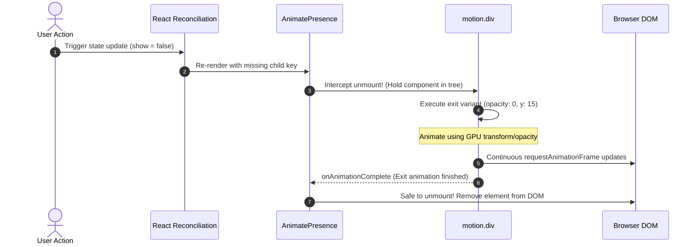
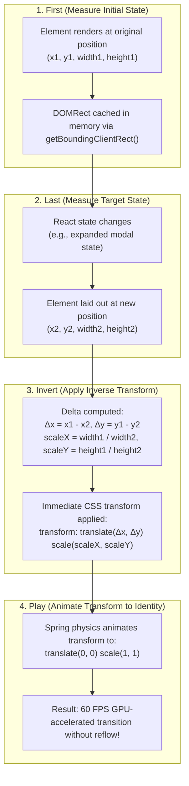
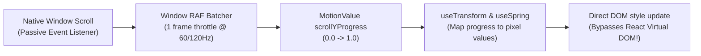

# ARCHITECTURE.md — Framer Motion Handbook Architecture

> Structural architecture, component registry design, lifecycle state machines, and hardware acceleration pipelines for the Framer Motion Handbook.

---

## 🏗️ 1. Registry & Component Taxonomy

The codebase is structured as a modular, self-contained component registry where each animation recipe is completely decoupled and immediately copy-pasteable:

```
framer-motion-book/
├── components/
│   └── motion/
│       ├── micro/                  # Micro-interactions (buttons, switches, tabs)
│       │   ├── MagneticButton.tsx
│       │   ├── SpringToggle.tsx
│       │   ├── AnimatedTabs.tsx
│       │   └── TiltCard.tsx
│       ├── layout/                 # FLIP layout and shared element transitions
│       │   ├── SharedElementModal.tsx
│       │   ├── ExpandableCardList.tsx
│       │   └── ReorderableList.tsx
│       ├── scroll/                 # Scroll-linked & parallax animations
│       │   ├── ParallaxHero.tsx
│       │   ├── ScrollProgressScrubber.tsx
│       │   └── StickyTimelineCards.tsx
│       ├── gestures/               # Drag, swipe, and physics sheets
│       │   ├── SwipeableBottomSheet.tsx
│       │   ├── DragToDismissCard.tsx
│       │   └── PullToRefreshIndicator.tsx
│       ├── overlays/               # Modals, command palettes, and popovers
│       │   ├── SpringModal.tsx
│       │   ├── CommandPalette.tsx
│       │   └── NestedDropdownMenu.tsx
│       ├── typography/             # Text reveals and typographic staggers
│       │   ├── SplitTextReveal.tsx
│       │   ├── TypewriterEffect.tsx
│       │   └── ScrambleText.tsx
│       ├── feedback/               # Notifications, toasts, and alerts
│       │   ├── StackedToastQueue.tsx
│       │   ├── SvgSuccessCheckmark.tsx
│       │   └── ShakeAlertBanner.tsx
│       └── loaders/                # Progress indicators and skeleton bars
│           ├── MorphingSvgLoader.tsx
│           ├── StaggeredSkeletonPulse.tsx
│           └── MetricCounter.tsx
├── hooks/                          # Reusable animation utility hooks
│   ├── useMagneticCursor.ts
│   ├── useScrollDirection.ts
│   └── useMeasureElement.ts
├── tokens/                         # Standardized spring physics & easing tokens
│   ├── springs.ts
│   └── easings.ts
├── registry.json                   # Machine-readable component catalog schema
├── AGENTS.md                       # Operational manual for AI coding assistants
├── ARCHITECTURE.md                 # System taxonomy and lifecycle flow
├── PRD.md                          # Product requirements and pattern specs
├── TESTING.md                      # Vitest and React Testing Library guidelines
├── DESIGN_SYSTEM.md                # Spring presets, timing curves, and tokens
├── SECURITY.md                     # Client-side XSS safety & sanitization
└── README.md                       # Catalog overview and live examples
```

---

## 🔄 2. AnimatePresence & Component Lifecycle Flow

Framer Motion orchestrates element removal from the React virtual DOM using `AnimatePresence`. Below is the exact lifecycle state machine:



---

## 📐 3. The FLIP Layout Animation Pipeline (`layout` & `layoutId`)

Framer Motion calculates layout transitions using the high-performance **FLIP** technique (**F**irst, **L**ast, **I**nvert, **P**lay):



---

## 📜 4. Scroll-Driven Animation Subscription Model

Traditional scroll event listeners run on the main browser thread and cause substantial lag. Framer Motion's `useScroll` uses passive, RAF-batched scroll observers:



### Key Architectural Invariant:
Updates to `MotionValue` (`useTransform`, `useSpring`) mutate the element's inline style directly via requestAnimationFrame, **bypassing React re-renders completely**. This ensures flawless 120 FPS performance even on low-powered mobile devices.

---

## 🛡️ 5. Next.js App Router & Server Component Boundary

Because Framer Motion relies on browser DOM events, `window`, and React hooks (`useRef`, `useState`, `useEffect`), all motion components must sit across the Client Component boundary:

```
Server Component (Page / Layout)
  │ (Data fetching, SEO tags, static HTML)
  ▼
Client Component Boundary ('use client')
  │
  ├── <MagneticButton /> (Client interactivity)
  ├── <SharedElementModal /> (Local state & AnimatePresence)
  └── <ParallaxHero /> (Scroll subscription)
```

**Rule**: Keep Server Components as close to the root as possible. Only mark individual interactive/animated components with `'use client'`.
